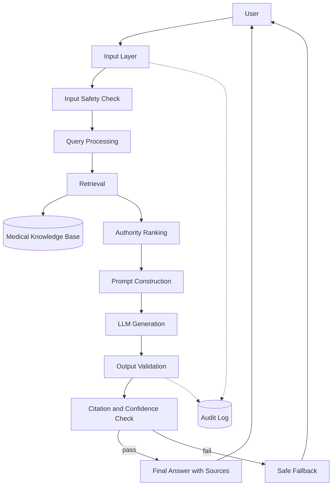
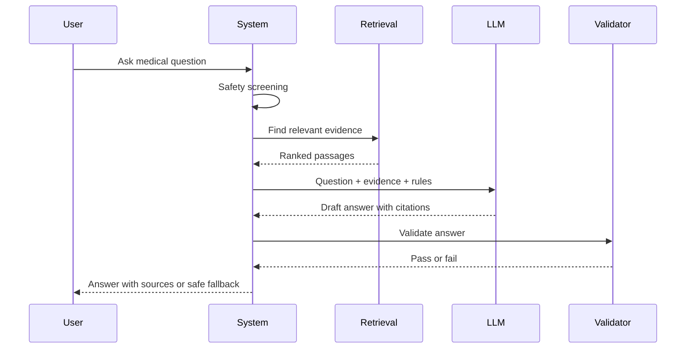
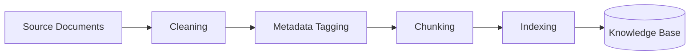

# Medical LLM Authority

A source-grounded medical question-answering system that answers only from trusted medical sources, cites its evidence, and declines to answer when the evidence is insufficient.

> **Disclaimer:** This project is for research and educational purposes only. It is not a medical device and does not replace professional medical advice, diagnosis, or treatment.

---

## Table of Contents

1. [Overview](#overview)
2. [Key Features](#key-features)
3. [System Architecture](#system-architecture)
4. [System Design](#system-design)
5. [Safety and Limitations](#safety-and-limitations)
6. [Roadmap](#roadmap)
7. [Contributing](#contributing)
8. [License](#license)

---

## Overview

General-purpose language models can produce fluent but unverified medical answers. **Medical LLM Authority** adds an authority layer between the user and the model:

- Answers are based on trusted medical sources.
- Every statement is linked to its supporting evidence.
- Low-confidence or out-of-scope queries are declined instead of guessed.

The goal is trustworthy, auditable output rather than maximum fluency.

## Key Features

| Feature | Description |
|---|---|
| Source-grounded answers | Responses are built from retrieved medical content |
| Source authority ranking | Higher-quality sources are given more weight |
| Citation enforcement | Answers without supporting evidence are rejected |
| Safety checks | Sensitive and emergency queries follow dedicated rules |
| Confidence control | Low-confidence answers are replaced with a safe refusal |
| Audit trail | Queries, evidence, and responses are traceable |
| Modular design | Each stage can be improved or replaced independently |

---

## System Architecture

### Layers

1. **Input layer** receives the user question.
2. **Input safety check** screens for emergencies, out-of-scope requests, and unsafe prompts.
3. **Retrieval layer** finds relevant passages from the medical knowledge base.
4. **Authority ranking** orders passages by source quality and relevance.
5. **Generation layer** produces an answer using only the retrieved evidence.
6. **Validation layer** checks citations, confidence, and safety rules before release.
7. **Audit log** records each step for review.

---

## System Design

### Request Flow

### Authority Ranking

Each retrieved passage is scored using these factors:

| Factor | Purpose |
|---|---|
| Relevance | How closely the passage matches the question |
| Source authority | Guidelines and reviews rank above general content |
| Recency | Newer evidence is preferred |
| Evidence level | Stronger study designs rank higher |

### Decision Policy

| Condition | Behavior |
|---|---|
| Emergency symptoms detected | Return urgent-care guidance, skip generation |
| No sufficiently relevant evidence | Decline and state that evidence is insufficient |
| Citation missing or unverifiable | Regenerate once, then fall back |
| Conflicting sources | Present both views and flag the conflict |
| Dosage or prescription request | Provide reference information with a clinician-consult notice |

### Data Flow

Each document keeps metadata such as source type, publication date, and evidence level. This metadata drives ranking and citation display.

---

## Safety and Limitations

- Answer quality depends on the coverage and freshness of the knowledge base.
- The system may decline valid questions when evidence is limited; this is intentional.
- It does not diagnose, prescribe, or replace a clinician.
- Emergency detection is not guaranteed to be complete.
- Do not enter identifiable patient data unless your deployment meets applicable privacy regulations.

---

## Roadmap

- [ ] Multilingual support
- [ ] Human-in-the-loop review
- [ ] Automated knowledge base updates
- [ ] Expanded evaluation coverage

---

## Contributing

1. Fork the repository
2. Create a feature branch
3. Commit your changes with clear messages
4. Open a pull request

---

## License

Distributed under the MIT License. See `LICENSE` for details.

---

## Author

**Osama Shabih**
GitHub: [@osamashabih6960](https://github.com/osamashabih6960)
