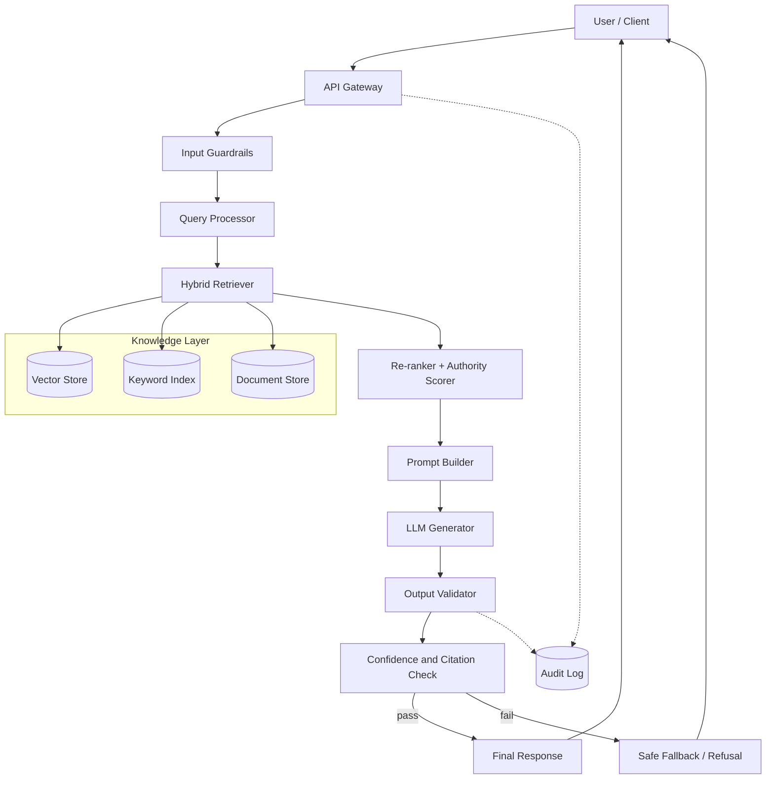
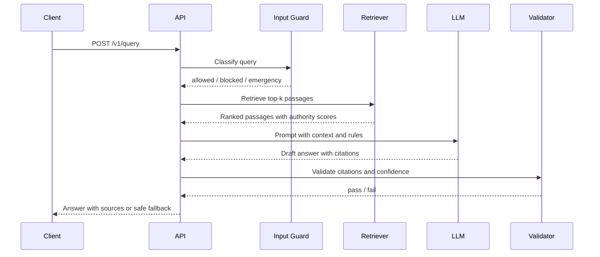
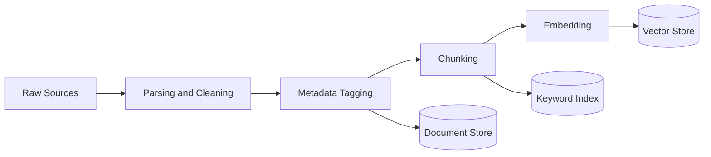

# Medical LLM Authority

A source-grounded medical question-answering system that answers only from trusted clinical literature, cites every claim, and refuses to answer when evidence is insufficient.


> **Disclaimer:** This project is for research and educational use. It is not a medical device and does not replace professional medical advice, diagnosis, or treatment.

---

## Table of Contents

1. [Overview](#overview)
2. [Key Features](#key-features)
3. [System Architecture](#system-architecture)
4. [System Design](#system-design)
5. [Tech Stack](#tech-stack)
6. [Project Structure](#project-structure)
7. [Getting Started](#getting-started)
8. [Configuration](#configuration)
9. [API Reference](#api-reference)
10. [Evaluation](#evaluation)
11. [Safety and Limitations](#safety-and-limitations)
12. [Roadmap](#roadmap)
13. [Contributing](#contributing)
14. [License](#license)

---

## Overview

General-purpose LLMs can produce fluent but unverified medical answers. **Medical LLM Authority** addresses this by putting an authority layer between the user and the model:

- Answers are generated only from a curated, versioned medical knowledge base.
- Every statement is linked to a source passage.
- Low-confidence or out-of-scope queries are declined or escalated instead of guessed.

The goal is trustworthy, auditable output rather than maximum fluency.

## Key Features

| Feature | Description |
|---|---|
| Retrieval-Augmented Generation | Answers are grounded in retrieved clinical documents |
| Source ranking | Guidelines and peer-reviewed sources outrank secondary content |
| Citation enforcement | Responses without valid citations are rejected |
| Safety guardrails | Emergency, dosage, and self-harm queries follow dedicated policies |
| Confidence scoring | Answers below a threshold are replaced with a safe refusal |
| Audit logging | Every query, retrieved context, and response is traceable |
| Modular design | Retriever, generator, and validator can be swapped independently |

---

## System Architecture



### Layers

**1. Interface layer**
REST API that receives queries, handles authentication, rate limiting, and request validation.

**2. Safety layer (input)**
Classifies the query before any retrieval. Detects emergencies, out-of-scope requests, and prompt-injection attempts.

**3. Retrieval layer**
Hybrid search combining dense vectors and keyword matching, followed by a re-ranker that applies authority weights per source type.

**4. Generation layer**
The LLM receives only the retrieved passages and a strict instruction to answer from them and cite them.

**5. Validation layer (output)**
Verifies that each claim maps to a retrieved passage, checks confidence, and applies medical safety rules before the answer is released.

**6. Observability layer**
Structured logs and metrics for audit, debugging, and evaluation.

---

## System Design

### Request flow



### Authority scoring

Each retrieved passage receives a final score:

```
final_score = w1 * semantic_similarity
            + w2 * source_authority
            + w3 * recency
            + w4 * evidence_level
```

| Source type | Authority weight |
|---|---|
| Clinical practice guidelines | High |
| Systematic reviews and meta-analyses | High |
| Randomized controlled trials | Medium-High |
| Textbooks and regulatory documents | Medium |
| Observational studies | Medium-Low |
| Other content | Excluded by default |

Weights are configurable in `config/authority.yaml`.

### Decision policy

| Condition | Behavior |
|---|---|
| Emergency symptoms detected | Return emergency guidance, skip generation |
| No passage above relevance threshold | Refuse, state that evidence is insufficient |
| Citation missing or unverifiable | Regenerate once, then fall back |
| Conflicting sources | Present both, flag the conflict |
| Dosage or prescription request | Provide reference information with a clinician-consult notice |

### Data pipeline



Each document carries metadata: source type, publication date, version, evidence level, and license. This metadata drives authority scoring and citation display.

### Scalability and reliability

- Stateless API workers behind a load balancer
- Vector store and document store scale independently
- Response caching for repeated queries
- Timeouts and circuit breakers around the LLM provider
- Versioned knowledge base so any answer can be reproduced

---

## Tech Stack

| Component | Technology |
|---|---|
| Language | Python 3.10+ |
| API | FastAPI |
| Embeddings | Sentence-Transformers / provider embeddings |
| Vector store | Qdrant or FAISS |
| Keyword search | BM25 |
| LLM | Configurable (API or local model) |
| Orchestration | Custom pipeline / LangChain |
| Storage | PostgreSQL |
| Containers | Docker, Docker Compose |
| Testing | Pytest |

> Update this table to match the stack you actually use.

---

## Project Structure

```
Medical-LLM-Authority/
├── app/
│   ├── api/              # Routes and request schemas
│   ├── guardrails/       # Input and output safety checks
│   ├── retrieval/        # Hybrid search and re-ranking
│   ├── generation/       # Prompt templates and LLM client
│   ├── validation/       # Citation and confidence checks
│   └── core/             # Config, logging, utilities
├── data/
│   ├── raw/              # Source documents
│   └── processed/        # Chunks and metadata
├── pipelines/            # Ingestion and indexing scripts
├── config/               # Authority weights and thresholds
├── evaluation/           # Benchmarks and test sets
├── tests/
├── docker-compose.yml
├── requirements.txt
└── README.md
```

---

## Getting Started

### Prerequisites

- Python 3.10 or newer
- Docker (optional, recommended)
- API key for your LLM provider, if using a hosted model

### Installation

```bash
git clone https://github.com/osamashabih6960/-Medical-LLM-Authority.git
cd -Medical-LLM-Authority

python -m venv venv
source venv/bin/activate        # Windows: venv\Scripts\activate

pip install -r requirements.txt
cp .env.example .env
```

### Build the knowledge base

```bash
python pipelines/ingest.py --source data/raw
python pipelines/index.py
```

### Run the service

```bash
uvicorn app.main:app --reload
```

### Run with Docker

```bash
docker compose up --build
```

The API is available at `http://localhost:8000` and interactive docs at `http://localhost:8000/docs`.

---

## Configuration

Key environment variables in `.env`:

| Variable | Description |
|---|---|
| `LLM_PROVIDER` | Model provider name |
| `LLM_API_KEY` | Provider API key |
| `EMBEDDING_MODEL` | Embedding model identifier |
| `VECTOR_STORE_URL` | Vector database connection |
| `TOP_K` | Number of passages retrieved |
| `MIN_CONFIDENCE` | Threshold below which answers are refused |

Authority weights and source policies are defined in `config/authority.yaml`.

---

## API Reference

### `POST /v1/query`

**Request**

```json
{
  "question": "What is the first-line treatment for type 2 diabetes?",
  "language": "en"
}
```

**Response**

```json
{
  "answer": "Guidelines recommend lifestyle modification together with metformin as first-line therapy for most adults [1][2].",
  "confidence": 0.87,
  "citations": [
    {
      "id": 1,
      "title": "Source title",
      "source_type": "clinical_guideline",
      "year": 2024,
      "passage": "Relevant excerpt"
    }
  ],
  "status": "answered"
}
```

`status` is one of `answered`, `refused`, or `emergency`.

### `GET /health`

Returns service status.

---

## Evaluation

| Metric | What it measures |
|---|---|
| Faithfulness | Share of claims supported by retrieved context |
| Citation accuracy | Citations that point to the correct passage |
| Retrieval recall@k | Relevant passages found in the top k |
| Refusal precision | Correct refusals on unanswerable queries |
| Latency | End-to-end response time |

Run the evaluation suite:

```bash
python evaluation/run.py --dataset evaluation/datasets/medqa_subset.json
```

---

## Safety and Limitations

- Output quality depends on the coverage and freshness of the knowledge base.
- The system can refuse valid questions when evidence is thin; this is intentional.
- It does not diagnose, prescribe, or replace a clinician.
- Emergency detection is rule- and model-assisted and is not guaranteed to be complete.
- Do not enter identifiable patient data unless your deployment meets applicable privacy regulations.

---

## Roadmap

- [ ] Multilingual support
- [ ] Knowledge graph integration
- [ ] Human-in-the-loop review interface
- [ ] Automated knowledge base update pipeline
- [ ] Expanded benchmark coverage

---

## Contributing

Contributions are welcome.

1. Fork the repository
2. Create a branch: `git checkout -b feature/your-feature`
3. Commit your changes with clear messages
4. Run tests: `pytest`
5. Open a pull request

---

## License

Distributed under the MIT License. See `LICENSE` for details.

---

## Author

**Osama Shabih**
GitHub: [@osamashabih6960](https://github.com/osamashabih6960)
